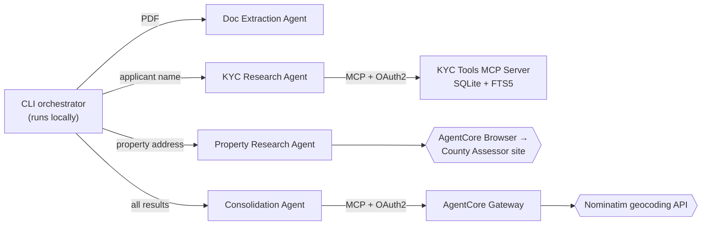

# AWS Agent Demo — Multi-Agent Mortgage KYC on Bedrock AgentCore

A multi-agent system that verifies a mortgage applicant end to end. It extracts data from submitted documents, researches the applicant and the property, checks that the workplace is within 30 miles of the property (primary residence rule), and produces an approve / deny / conditional recommendation.

Every agent runs as a container on **Amazon Bedrock AgentCore Runtime**. Terraform deploys the whole stack, and a local CLI orchestrates the pipeline. All data is synthetic.

## Architecture



1. **Doc Extraction**: turns each PDF page into an image, has Claude classify it (mortgage application, W2, pay stub, driver's license) and extracts typed fields with Pydantic.
2. **KYC Research** (runs in parallel with step 3): fuzzy-searches credit, income, property and lien records through an MCP server.
3. **Property Research** (runs in parallel with step 2): drives a managed browser through the Clark County NV assessor site and records screenshots to S3. It runs asynchronously, and the CLI polls it.
4. **Consolidation**: geocodes both addresses through the Gateway, computes the haversine distance and writes the risk assessment.

## Stack

| Layer | Tech |
|---|---|
| Model | Claude Sonnet 4.6 on Amazon Bedrock (`global.anthropic.claude-sonnet-4-6`) |
| Agents | Python 3.12, [Strands Agents](https://github.com/strands-agents/sdk-python), `bedrock-agentcore` SDK |
| Tools | MCP (FastMCP), SQLite FTS5, AgentCore Browser + Code Interpreter |
| AWS | AgentCore Runtime / Gateway / Memory / Identity, Cognito, ECR, CodeBuild, S3, Secrets Manager, CloudWatch, X-Ray, IAM |
| Infra | Terraform (AWS provider 6.x), Docker (ARM64) |
| CLI | Rich, boto3 |

## Repo layout

```
agent_code/
├── doc_extraction_agent/      # PDF → classified, structured fields
├── kyc_agent/                 # applicant research via MCP tools
├── kyc_tools/                 # MCP server + kyc_data.db (synthetic)
├── property_research_agent/   # browser-based property lookup
└── consolidation_agent/       # geocoding, distance check, recommendation
cli/                           # orchestrator
terraform/                     # full AWS deployment (+ reusable modules)
sample_data/
├── input/sample_documents.pdf # 4-page sample application
├── api_schemas/               # OpenAPI spec the Gateway turns into MCP tools
└── SCHEMA.md                  # database schema
```

## Prerequisites

- An AWS account with Bedrock model access to Claude Sonnet 4.6, and credentials configured locally
- Terraform ≥ 1.11
- Python 3.12 (with [`uv`](https://github.com/astral-sh/uv) recommended)

Docker is not needed locally. Images are built in AWS CodeBuild.

## Deploy

```bash
export AWS_REGION=us-west-2   # any region with AgentCore + Bedrock
cd terraform
terraform init
terraform apply
```

This builds and pushes five images, then creates the runtimes, the gateway, Cognito, memory and the S3 bucket. The first apply takes roughly 10–15 minutes.

## Run

From the repo root:

```bash
uv venv .venv && source .venv/bin/activate
uv pip install -r cli/requirements.txt
python cli/cli.py sample_data/input/sample_documents.pdf
```

The CLI reads the agent ARNs from `terraform output`. You can also set `DOC_EXTRACTION_AGENT_ARN`, `KYC_AGENT_ARN`, `PROPERTY_RESEARCH_AGENT_ARN` and `CONSOLIDATION_AGENT_ARN` instead. A full run takes 3–5 minutes. Browser replays and generated code are saved to `artifacts/<timestamp>/`.

## Tear down

```bash
cd terraform && terraform destroy
```

## Notes

- This is a demo, not a hardened production system. The CLI runs locally, every call uses the same runtime user, and the deployment uses a single region.
- Based on the AWS "Multi-Agent KYC Workshop" (Bedrock AgentCore).
